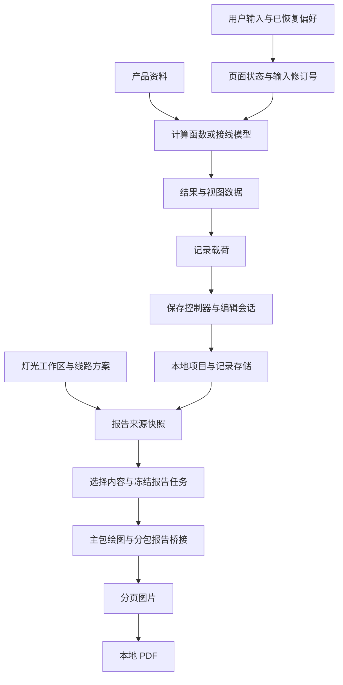

# 音频工具架构分析与报告链路重构

当前项目已经分离计算、产品资料、页面交互和报告绘制，适合继续做局部重构。主要维护风险集中在大页面的状态协调、存储模块的职责集中，以及控制器之间重复的异步生命周期。整体改写或统一全部工具控制器，会扩大对计算与存储行为的影响，本轮采用报告链路这一范围明确的切口。

后续已按本报告优先级完成存储拆分、编辑依赖解环、DMX 与项目布线控制器拆分、项目列表索引及测试工具整理，保持现有 UI 和业务语义。逐步验证、最终文件清单与结果见[后续重构验收记录](qa/architecture-continuation-2026-10-25.md)。下文架构统计和问题描述保留初次分析时的工作区口径。

分析基于 2026-10-25 本轮开始时的工作区，包含此前未提交修改；不把 Git HEAD 当作重构前版本。起始生产文件哈希与改动文件副本位于 `tmp/architecture-refactor-2026-10-25/`。

业务边界依据 [README](../README.md)、[计算说明](calculation.md)、各工具领域函数和[发布自检](../tests/release-check.js)。本轮保留 `0 dBFS = +18.4 dBu` 的既有校准条件，以及现有产品参数、输入输出校验和记录存储语义。

## 架构和模块边界

`app.json` 注册 28 个页面，其中主包 19 个页面，另有 5 个分包。三个 tab 是工具、项目和依据。`app.js` 主要初始化主导航状态，不承担计算或存储业务。项目采用原生微信小程序、CommonJS 模块与页面方法组合，没有必要为本次重构引入框架或依赖。

| 层次 | 主要入口 | 职责和边界 |
| --- | --- | --- |
| 页面与导航 | `pages/tools/`、`pages/projects/`、`utils/primary-navigation.js`、`utils/tool-registry.js` | 工具目录、路由、可见性与页面交互 |
| 工具控制器 | `pages/spl/spl.js`、各页项目控制器、`pages/dmx-layout/page-factory.js` | 输入状态、延迟计算、弹层、结果刷新与生命周期 |
| 计算与领域模型 | `utils/limiter.js`、`utils/spl.js`、`utils/cable.js`、`utils/camera-fov.js`、`utils/gain-structure.js`、`utils/dmx-address.js`、`utils/led-screen.js`、`utils/project-wiring.js` | 参数到结果或接线方案的转换；UI 重构必须保持其输入输出合同 |
| 产品资料 | `data/`、DMX 分包资料、`utils/products.js` | 型号参数、来源和检索；产品检索已有按类型懒加载与索引缓存 |
| 本地持久化 | `utils/records.js`、`utils/result-record-context.js`、`pages/dmx-layout/lighting-workspace.js` | 项目、记录、独立收藏、编辑会话、备份恢复与灯光工作区 |
| 报告 | `pages/records/report-model.js`、`report-snapshot-adapter.js`、两个 `report-bridge.js`、`report-pdf-export.js` | 冻结项目内容，复用原生绘图，经分包桥接汇总图片并导出 PDF |
| 横切能力 | `utils/haptics.js`、`utils/performance.js`、`utils/report-image-actions.js` | 触感、开发环境计时、图片操作与失效回调检查 |

静态相对路径 `require` 扫描在重构前覆盖 127 个生产 JS，全部可从注册页面和 App 入口到达。扫描把方法内延迟加载也计作依赖，因此“可达”不等于启动时全部加载，也不能据此证明所有导出或方法都被使用。扫描结果保存在 `architecture-metrics.json`。

## 主要数据流

以声压级为例，页面把产品选择和距离等状态传入 `calculateSpeakerSpl`，整理结果并通过 `setData` 刷新界面。输入修订号用于废弃旧计算、旧图片和旧保存动作；结果载荷包含恢复计算所需的偏好。偏好保存、收藏保存和项目归档有各自的语义，不能为了复用代码合并成同一种写入。

保存到项目时，控制器冻结结果，重读目标项目，并在确认更新前后核对项目和元数据。`records.js` 按参数签名处理记录关联，收藏采用独立快照；编辑上下文另外保存待完成的保存令牌和偏好恢复状态。存储读失败、迁移失败和未来版本数据均有阻止覆盖的路径。这些保护是重构必须保留的合同。

报告通过 `loadProjectReportSource` 重新读取项目记录、项目线路和灯光方案，形成独立快照。原生图片适配器把任务分给主包绘图或两个分包桥接页。桥接使用 ticket、revision、fingerprint 回传身份；父页与子页分别负责自己的有效性判断。PDF 按图片页转换 JPEG 并本地组装，已有页数、尺寸和字节数上限及取消清理流程。

## 重构前的问题和优先级

下表中的优先级是后续重构顺序，不代表已经证实的线上故障等级。

| 优先级 | 问题及证据 | 影响 | 处理方式 |
| --- | --- | --- | --- |
| 高 | 两个分包报告桥接页重复实现 `onLoad`、`onUnload`、`finish`、`cancel`，仅 bridge 标识和取消文案不同 | 订阅清理、回传顺序或取消保护修复时容易遗漏另一页 | 本轮提取共享生命周期；各自快照校验、绘图、分页保持原样 |
| 高 | `records.js` 在起始快照中有 1389 行，被 19 个不同生产文件引用，集中缓存、迁移、项目、记录、收藏、恢复和线路存储 | 修改影响面大，模块级缓存与失败标志增加拆分难度 | 后续先冻结存储操作轨迹，再逐步拆底层读写与迁移；保留原 API 门面和模块实例状态 |
| 中 | `result-record-context.js` 在离开编辑的方法中加载 `result-record-actions.js`，后者在顶层反向加载上下文 | 延迟加载当前避开了直接初始化递归，但模块边界依赖调用时机 | 后续把离开编辑动作作为依赖传入；同时验证取消、原生返回、草稿恢复与重试 |
| 中 | DMX 编址入口 2820 行、85 处 `setData` 调用；项目布线 `workspace-ui.js` 1728 行；这些都是起始快照的静态计数 | 输入、弹层、手势、保存与导出状态相互协调，阅读和回归成本高 | 按状态所有权拆职责；先覆盖状态切换，再搬迁，不以单纯缩短文件为目标 |
| 中 | `pages/projects/projects.js` 的项目映射中逐项 `lightingRows.find` | P 个项目和 L 个灯光上下文产生 O(P×L) 查找；大数据时可能放大刷新耗时 | 后续先建立一次索引；保留 `find` 对重复 ID 取首项的行为，并测大项目刷新 |
| 中 | 报告 `asSelectionSections` 调用两次 `getProjectReportSections`，第一次展开为未使用的 `items` | 每次重建选择列表都会多构建一次分组、设备索引和条目数组 | 本轮删除未使用的第一次构建，不增加跨刷新缓存 |
| 中 | 发布自检约 5300 行；DMX 三份编译脚本字节相同，第四份结构相近；现行测试与历史快照共存 | 入口和源码位置变化时维护成本高，可能出现历史测试被误认为当前验收 | 本轮登记桥接回归；后续共享编译工具，保留历史入口和证据，逐个拆分自检专题 |

算法文件较小并不代表整个页面便宜，`setData` 调用多也不代表已经掉帧。当前更值得测的是状态整理、同步存储读取、视图载荷和图片导出。`utils/performance.js` 已支持开发版与体验版计时，最多保留 120 条样本；应分别记录正常、取消和失败路径。正式版默认不启用这些测量。

重构前完整自检报告的源码资源口径：总计 4825.5 KiB / 5120 KiB，主包 JS 1486.2 KiB / 1536 KiB。主包 JS 余量约 49.8 KiB，新增通用抽象需要考虑其被放入主包的成本。以上不是微信最终编译包大小，也不是设备运行内存。

性能测量方法参照[重点页面性能测量](performance-measurement.md)，仅沿用仍在源码中的测量点；该旧文档还列有已退役功能，不能直接当作当前路由清单。

## 本轮重构方案和代码边界

共享 `createReportBridgeLifecycle({ bridge, cancelMessage })` 仅负责通道订阅、卸载清理、单次结果回传和取消入口。两个页面通过对象展开组合这四个方法。共享模块在方法执行时使用 `wx`，保持运行环境替换时的行为，避免模块初始化时捕获平台 API。

两个桥接页面的 `begin` 有不同的批次校验与重复请求行为，`_isCurrent` 的实现也不同。本轮全部保留，不把外观相近的业务逻辑强行合并。绘图、Canvas 尺寸、分页算法、错误文案、原有导出和初始数据同样保持不变。

报告选择列表仅移除没有使用结果的构建：分组函数从调用两次减为一次，时间复杂度仍是线性，临时对象分配减少。没有引入可能导致项目内容过期的缓存，也不据此宣称帧率或整体导出速度提升。

| 本轮文件 | 改动 |
| --- | --- |
| `utils/report-bridge-lifecycle.js` | 新增两个分包页共用的四个生命周期方法 |
| `pages/audio-wiring/report-bridge.js` | 接入共享生命周期，保留接线快照校验和分段绘图 |
| `pages/project-wiring/report-bridge.js` | 接入共享生命周期，保留项目线路校验和分页绘图 |
| `pages/records/report.js` | 删除一行未使用的分组构建 |
| `tests/report-bridge-lifecycle-regression.cjs` | 新增真实页面的生命周期合同和选择列表回归；支持本地快照差分 |
| `tests/release-check.js` | 仅登记新增生命周期回归与既有桥接集成回归 |
| `docs/architecture-refactor-2026-10-25.md` | 架构、问题、方案与验证记录 |

三个被修改的生产文件加新 helper，总计由 63743 bytes 减至 62030 bytes，净减 1713 bytes、41 行。最终源码包门禁统计总计 4823.8 KiB，主包 JS 1488.4 KiB；共享 helper 进入主包，因此总量减少而主包 JS 增加约 2.2 KiB，仍在原有预算内。没有修改包体阈值。

## 后续重构的验收条件

1. 存储拆分：对比迁移、成功写入、逐键写失败、回滚失败、未来版本拒绝、恢复重试的读写轨迹，记录 ID、保存令牌和项目归属保持一致。
2. 编辑依赖解环：主入口与被依赖模块可以独立加载，取消返回不写入，确认保存只产生原有次数的写入，中断后恢复不重复生成记录。
3. 大页面拆分：公开页面方法、初始数据、用户事件轨迹与结果载荷保持一致；定时器、平台 API 和私有状态的归属明确。
4. 项目列表性能：在包含无灯光、重复上下文 ID、空项目和大量记录的样本上，输出逐字段相同；再测冷读、热读和 `setData` 载荷，不能只凭 O 表达式报提速。
5. 测试工具整理：原命令入口、编译输入集、失败退出码和发布阈值保持不变；历史快照仍可定位，不能为适配重构删除业务断言。

## 验证记录

执行由 GPT-6 Luna reasoning `max` 完成，当前对话模型独立检查实际源码、方法和哈希，并重新执行回归。

| 检查 | 结果与范围 |
| --- | --- |
| 重构前完整自检 | `node tests/release-check.js` 退出码 0 |
| 重构前后行为差分 | `node tests/report-bridge-lifecycle-regression.cjs --compare-before` 退出码 0；两个真实桥接 Page 的事件轨迹和状态一致，选择列表输出一致 |
| 日常生命周期回归 | 默认测试不依赖 `tmp`；固定订阅和 ready 顺序、结果与返回完成事件顺序、取消文案、幂等和卸载清理；每个桥接页覆盖 10 个场景 |
| 既有桥接集成回归 | `report-bridge.test.cjs` 退出码 0，包含线路完整性、迟到回调、双重返回信号和 500 ms 返回等待及定时器清理 |
| JS 语法 | 四份生产 JS、生命周期测试与发布入口共六个文件的 `node --check` 通过 |
| 官方模板与样式编译 | 受影响三页及其依赖共 3 个 WXML、5 个 WXSS，`wcc` / `wcsc` 退出码均为 0；最终核对编译输入哈希未变 |
| 最终完整自检 | `node tests/release-check.js` 退出码 0，stderr 为空，两个桥接回归均实际执行；原有数值、产品资料、存储与包体门禁通过 |
| 独立范围检查 | 起始清单中的生产文件仅三页 JS 变化，新增生产文件仅共享 helper；算法、数据、存储、模板、样式和配置哈希未变；发布入口仅增加两项测试登记 |
| 差异空白检查 | 全仓 `git diff --check` 退出码 0 |

选择列表的局部构建从两次减至一次；包含页面另一次必要源分组的加载流程，测试计数由 3 次减至 2 次。两个计数描述的范围不同。

独立复审记录保存在 `tmp/architecture-refactor-2026-10-25/independent-review.json`，完整自检日志为同目录 `final-release.stdout.log`、`final-release.stderr.log`，编译记录为 `compile/summary.json`。本地 `--compare-before` 依赖本轮起始快照；默认发布回归依赖持久断言，不依赖该目录。

初次报告链路重构的自动化验证阶段没有进行微信开发者工具完整 JS 包构建、真机操作或性能采样。后续八步重构和逐步验证已完成；2026-10-25，用户在本次对话中确认“真机测试没问题”，本次重构最终验收状态更新为通过，详见[后续验收记录](qa/architecture-continuation-2026-10-25.md)。真机结果来源为用户实测确认，未提供设备及逐项用例详情；完整 JS 包构建未单独记录，真机性能未提供采样数据，不能以 Node 回归或模拟基准代替。
