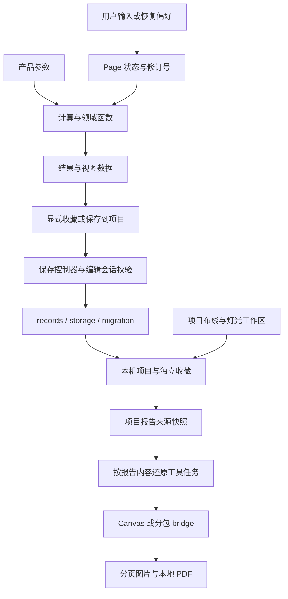

# 6.0.3 阶段结束后的架构复审与重构

## 范围与结论

本轮重新检查当前源码，不将 2026-10-25 的初次报告当作现状。起点为 `c7e9b08`（6.0.3）加工作区现有改动。用户确认产品型号交叉引用工作已完成、尚未提交；本轮将其纳入分析，但不修改该功能、产品数据或既有 UI。

项目已经建立了计算、产品数据、本地存储和报告的分层，不需要整体改写。上一轮已完成的存储 I/O 与迁移拆分、编辑依赖解环、项目列表索引和部分页面控制器拆分仍然有效。本轮重点转向当前仍存在的报告加载依赖、故障恢复边界、重复的保存控制器和验证工程成本。

2026-11-03 首批报告加载改进保持计算公式、校准基准、产品数据、输入输出校验、记录与收藏语义、项目存储结构和 UI 不变；该阶段未进行 Git 提交、推送或正式版上传。后续阶段的界面范围不同：2026-11-04 收藏入口导航修正按验收调整了页脚入口文案与触区，因此本报告覆盖的全部阶段不能概括为 UI 完全不变。各阶段真机验收只对应各自的候选版本，不自动覆盖其他阶段的新改动。

## 当前架构

| 层次 | 当前入口 | 职责与边界 |
| --- | --- | --- |
| 应用与导航 | `app.js`、`app.json`、`utils/primary-navigation.js`、`utils/tool-registry.js` | App 初始化主导航；工具、项目、依据三个 tab；页面按工具注册 |
| 页面编排 | 各工具主 Page、同目录 `*-project.js` / `*-report.js` 等 | 用户事件、输入修订、弹层、键盘、异步取消、view model 与 `setData` |
| 计算与领域模型 | `utils/limiter.js`、`spl.js`、`cable.js`、`camera-fov.js`、`gain-structure.js`、`led-screen.js`、`dmx-address.js`、`project-wiring.js` | 计算和领域输入输出；不因界面或复用需求改变基准 |
| 产品与资料 | `data/`、`pages/products/data/`、`pages/products/utils/`、DMX 分包数据 | 设备参数、资料检索、已完成的型号交叉引用；缺失参数继续明确保留 |
| 最近输入与编辑会话 | `utils/preferences.js`、`result-record-context.js`、`result-record-actions.js` | 最近输入与项目/收藏的持久化语义不同；编辑会话包含修订、待保存令牌及恢复状态 |
| 项目、记录与收藏 | `utils/records.js`、`record-storage.js`、`record-migration.js` | 记录关联、独立收藏、回收站、迁移及本机存储；项目布线有版本检查 |
| 灯光工作区 | `pages/dmx-layout/lighting-workspace.js` 及 DMX 页面控制器 | 灯组、灯位、临时/项目上下文、版本冲突检查与写入 journal |
| 图片与项目报告 | 各工具 renderer、`pages/records/report-model.js`、`report-snapshot-adapter.js`、分包 report bridge、PDF 导出 | 根据冻结快照还原工具图片，经本地 Canvas、图片分页与 PDF 输出 |
| 横切能力 | `pages/native-image-preview.js`、`pages/result-image-theme.js`、`utils/performance.js`、共享样式 | 原图返回生命周期、生成时主题、开发计时和通用界面样式 |

当前注册 28 个页面：17 个主包页面，6 个分包共 11 个页面。静态 Wi-Fi 预下载仅包含接线助手、项目布线和灯具编址三个分包；控制协议与产品资料库按需加载。

本轮相对路径字面量 `require` 扫描覆盖 140 个生产 JS；从 App 和注册页面的 29 个入口均可到达，未发现未解析的相对引用或循环依赖。该扫描包含函数内延迟引用，并非 JavaScript 完整语义分析；“可达”不代表启动时装载，也不能证明每个导出都在使用。

普通计算不自动写入历史；最近偏好、收藏快照、项目记录和编辑会话各有独立用途。项目报告先冻结来源，再还原任务和生成图片。重构不能把这些不同写入统一成一种“保存”，也不能去掉 revision、requestId、episode 或回传身份检查。

## 问题清单与优先级

优先级用于安排工作，并不表示所有条目都是线上故障。

| 优先级 | 性质与证据 | 影响及处理要求 |
| --- | --- | --- |
| P1 | **条件性存储故障风险（普通多键写入已增加恢复协议，仍有未闭合边界）**：`utils/record-storage.js` 的 `writeValuesAtomically` 使用版本化内部 undo journal，支持重启恢复 | 普通多键保存的业务 API 和数据结构不变，存储 schema 仍为 v4；新增独立 journal key。提交删除后读回仍无法判定时会阻断，但不能保证 `false` 必然代表旧值已恢复。用户已确认所列真机正常操作通过，但物理存储故障未真机注入，额外空间和同步 I/O 开销未定量测量；`writeRawSnapshot` 与迁移备份还原各自回滚失败仍待后续处理 |
| P1 | **源码包预算余量较小**：本轮初始有效包 294 文件，总计 5,217,120 / 5,242,880 bytes；DMX JS 357,068 / 360,448 bytes | 总量余约 25.16 KiB，DMX JS 余约 3.30 KiB。每次增加共享模块或分包副本都应记录预算变化，不通过提高阈值掩盖膨胀；此为仓库源码门禁，不是微信编译包实测 |
| P2 | **项目报告入口加载无关依赖**：`report.js` 顶层引入 `report-snapshot-adapter.js`，适配器顶层引入多种计算器和所有工具绘图器 | 起始冷 Node 载入共 34 模块、528,240 bytes。按真实报告分支加载独有依赖，保持绘图、历史校验与取消行为；本轮首批实施 |
| P2 | **大控制器职责集中**：DMX 主入口 96,440 bytes / 2,459 行，68 处 `setData`；灯位图工厂 65,855 bytes，摄像机入口 65,568 bytes | 行数和调用次数不是卡顿证据，但增加状态理解和回归成本。下一阶段按“上下文保存”“待确认操作与撤销”等现有边界搬迁，保持 Page 方法与状态所有权 |
| P2 | **项目保存流程多份复制**：七个工具控制器各自维护元数据快照、迟到回调、键盘 episode 和保存状态；部分窗口读取函数相同 | 不能直接合并状态机，因为事件条件和失败恢复存在差异。先对照操作轨迹，再提取完全等价的纯辅助函数；本轮不触碰已验收的输入/键盘行为 |
| P2 | **SPL 完整 VM 场景未全部登记到主门禁**：键盘 wrapper 仅选择全套 11 场景中的 3 个 | 其余场景可能在别处有部分重叠，不能称完全无覆盖。本轮登记全套，继续保留原键盘专门入口；独立全套在本轮起点已经通过，旧的 reset 测试失败不再列作当前问题 |
| P2 | **历史快照适配成本持续上升**：`tests/package-reclaim/ui-resources.cjs` 1,123 行，DMX 编译入口回归 672 行，多层批准变更归一化 | 当前包含数量、绑定和摘要检查，不能称测试无效。后续逐项把当前语义合同与历史证据分离，先做覆盖映射，禁止直接删除断言或全量刷新摘要 |
| P2 | **自检反复扫描归档**：同轮三次根目录遍历加一次 assets 遍历；工作区约 42,512 文件，实际包 294 文件 | 桌面只读测量：目录枚举合计约 1.80 秒；7,554 个 JS 的读取解析另约 6.12 秒、195 MB。可按单次检查复用枚举，不擅自减少语法检查集合；不是手机运行瓶颈 |
| P2 | **测试子进程缺少超时边界**：发布入口顺序 `execFileSync`，未设置 timeout | 本轮未遇到挂起；未来一个未释放定时器可阻塞整轮。集中 runner 可增加单测试耗时、合理超时与失败上下文，同时保留退出码和原错误 |
| P3 | **当前文档描述滞后**：README 已写 6.0.3，但部分工具仍称“当前 6.0.0 候选”，目录有不存在的 `utils/products.js` | 更新当前描述和实际路径，保留历史验收日期、范围和旧报告原文；本轮同步 |

各源码行数按换行分割，包括空行；统计起点与后续修改不能混用。文件大可能来自固化数据：型号交叉引用为 150,151 bytes 的数据文件，不把它当成 15 万字节的页面控制器。

## 重构顺序与验收合同

1. **本轮：报告依赖按需加载。** 保持字面量相对 `require` 和 CommonJS 缓存，不新增依赖或框架；模块输入、输出、布局、绘图指令及旧记录降级路径一致。检查空载、单工具、跨工具、重复生成和取消返回；比较 Node 冷载入依赖图，不承诺真机整体提速。
2. **本轮：补齐验证与当前文档。** 登记全部 SPL VM 场景，保留现有门禁与阈值；更新 README 当前架构。现有产品型号交叉引用登记不得丢失。
3. **第二批实现及所列真机功能验收已通过（2026-11-04）。** 版本化 undo journal 覆盖重启恢复、缓存失效、重复恢复和再次写失败；用户确认所列正常存储路径均正常。物理故障注入、额外空间与同步 I/O 耗时的量化仍未完成；`writeRawSnapshot`、迁移备份还原自身回滚失败留作后续专项。
4. **随后：大控制器与纯 helper。** 每次只迁移一个职责，核对公开方法、初始 data、事件顺序和存储轨迹；不统一具有真实差异的业务 guard，不批量重写所有页面。
5. **测试工程整理。** 保留历史证据；迁移当前断言时逐项映射覆盖，再优化扫描和 runner。扫描必须保留 `.git` 处理差异、原顺序与原文件集合，不能通过删检查实现“加速”。

“首批完成”指 2026-11-03 的架构复审、证据化方案与报告加载等改进完成，不表示整张待办表已经解决。普通多键写入恢复已在 2026-11-04 第二批中实现，所列正常路径也已通过用户真机确认；真机故障注入、额外空间与 I/O 耗时量化、提交状态不可判定及手动快照/迁移备份还原风险仍待验证或处理。

## 验证与测量记录

- 起始完整 `node tests/release-check.js` 退出码 0；日志位于 `tmp/architecture-reaudit-2026-11-03/baseline-release.*.log`。
- 起始源码预算：总计 5094.8 / 5120.0 KiB；主包源码资源 2358.8 / 2460.0 KiB；主包 JS 1498.3 / 1558.0 KiB。阈值沿用本轮起点，不以历史报告的旧阈值替代。
- 报告适配器起始冷 Node 测量：9 个独立子进程，34 模块、528,240 bytes，中位数 29.084 ms，P95（9 样本取最大值）31.494 ms。样本小，仅辅助判断依赖工作量，不是设备端基准。
- 回滚失败 mock 只操作内存对象，没有访问微信或真实用户存储。复现数据位于 `storage-rollback-reproduction.json`。
- 本轮生产文件起始哈希、静态依赖图和统计分别在 `start-manifest.json`、`dependency-graph.json`、`metrics.json`。全部证据文件在上述临时目录，不作为运行时依赖。
- 最终完整 `node tests/release-check.js` 退出码 0，stderr 为 0 bytes；包括新增加载隔离、详细适配器回归和 SPL 全部 11 场景。证据在 `release-final/release.stdout.log`、`release-final/release.stderr.log`。

完整自检、Node 绘图模拟和 WXML/WXSS 编译均不能代替微信完整 JS 打包与真机测量。本轮报告链路的功能验收依据是下文 2026-11-03 的用户实测确认，未借用上阶段设备选择窗口的验收结果。

### 报告加载前后测量

| 独立冷进程测量范围 | 前：模块 / 源码 bytes | 后：模块 / 源码 bytes | 前中位数 / P95 | 后中位数 / P95 |
| --- | ---: | ---: | ---: | ---: |
| 单独导入 `report-snapshot-adapter.js` | 34 / 528,240 | 1 / 50,859 | 29.084 / 31.494 ms | 3.263 / 4.093 ms |
| 导入真实 `pages/records/report.js`，仅模拟 `Page` 注册 | 40 / 626,050 | 10 / 154,041 | 31.364 / 48.542 ms | 7.316 / 7.751 ms |

每组 9 个全新 Node 子进程；第二组用起始适配器源码在原模块路径下执行，页面及其他依赖保持当前版本。没有执行页面 `onLoad`、真实微信存储或 Canvas。依赖数与字节数表示该次模块求值实际载入的源码，不是打包体积，也不是内存占用。耗时受桌面环境影响，不作硬门禁，不据此声称手机首屏提升相同比例。

改动将对应工具的初始化工作延迟到生成该工具报告时，仍需执行该工作；完整多工具报告并未省掉所有工具的初始化。所有 `require` 仍为静态字面量相对引用，CommonJS 缓存负责重复调用复用，没有新增自建缓存。若某个工具依赖本身无法加载，错误会延迟到相应报告条目，由现有页面任务规划边界报告，而不在适配器导入时阻断所有条目；新增回归覆盖此失败隔离行为。

## 本轮已完成的代码与验证

| 本轮文件 | 实际改动 |
| --- | --- |
| `pages/records/report-snapshot-adapter.js` | 将工具独有依赖移动至实际使用函数内；保留原函数签名、计算/校验表达式、绘图与取消流程；未新增运行时模块 |
| `tests/report-snapshot-adapter-load-regression.cjs` | 新增适配器空载、限幅器单分支加载、依赖失败隔离、bridge 继续与 CommonJS 缓存复用检查；默认执行不依赖本机起始快照 |
| `tests/release-check.js` | 追加上述测试、原有详细适配器测试、SPL 完整 VM 测试，登记数从 111 增至 114；既有产品型号交叉引用登记与全部旧入口保留 |
| `README.md` | 同步当前版本、目录与职责，补充本轮报告入口，明确历史验收阶段 |
| 本报告 | 当前架构、问题证据、实施结果与下一阶段顺序 |

执行由 GPT-6 Luna reasoning `max` 完成，当前对话模型独立审查实际生产差异，并重新执行加载隔离与前后绘图对照。

- 详细适配器回归通过，涵盖现有多工具原生图片、接线桥接、项目线路、灯位和长 DMX 分页。
- 同进程起始版本/当前版本逐字段深比较通过：8 类内容、9 个绘图任务、3,671 次 Canvas 调用一致；比较还包含任务尺寸、分段和灯位覆盖 ID。这是 Node 夹具验证，不是手机截图像素对比。夹具含动态内容，不把某次输出摘要当成跨运行的固定基准。
- 加载失败注入验证只将错误归属到对应报告条目，独立项目布线 bridge 仍可规划；正常重复调用复用原模块缓存。
- SPL 完整 11 场景和原键盘 3 场景入口均通过；没有去掉原键盘入口来缩短检查。
- JavaScript 语法和本轮差异空白检查通过。核对起始 312 个文件哈希，只有报告适配器和 README 改变，其他算法、产品数据、UI、存储及现有型号交叉引用文件保持原样。
- 最终源码门禁总计 5095.1 / 5120.0 KiB，主包源码资源 2359.1 / 2460.0 KiB，主包 JS 1498.6 / 1558.0 KiB；适配器源码净增加 265 bytes，所有阈值保持不变。延迟加载不等于缩小包体。

**状态：本轮架构复审及首批改进验收通过（2026-11-03）。** 自动化验证和独立复审已完成；用户按本轮报告链路真机测试清单回复“全部正常”。本次验收不代表上表中的存储回滚失败风险、大控制器拆分等后续事项已经解决。

用户确认的测试范围：使用已有项目，仅选择一个计算工具生成报告；生成包含多个计算工具及已有接线、布线或灯位内容的报告；生成过程中取消再重试，检查分页预览和 PDF。用户未反馈异常或未覆盖项。

真机结果来源为用户实测确认，未提供本次设备型号、系统及微信版本、逐项截图或耗时样本，不据此补写设备覆盖或真机性能提升结论。代理未执行微信预览上传；本次未修改 WXML/WXSS，因此没有重复执行模板/样式编译。代码及报告仍未提交或推送。

## 第二批：普通多键存储写入故障恢复（2026-11-04）

普通 `writeValuesAtomically` 写入改为先持久化版本化 undo journal，再写入业务值；journal 白名单为 `records`、`projects`、`favorites`、`recovery`，保存 raw 值及原始存在状态。journal 删除作为提交点，并按原始读回结果区分已提交、仍待回滚和无法判定；损坏/未来版本日志及不兼容 schema 会保留现场并阻断业务读写。schema 保持 v4，journal 是额外内部存储；正常保存的公共 API、业务数据结构与结果、UI、算法和产品数据未改变。日志需要临时存储空间，若无法写入日志则拒绝本次保存，不绕过保护直接写业务数据。

- 本批涉及 8 个代码/测试文件：生产文件 `utils/record-storage.js`、`utils/records.js`；新增测试 `tests/record-write-recovery-regression.cjs`、`tests/record-write-journal-public-regression.cjs`；适配测试 `tests/record-storage-refactor-regression.cjs`、`tests/result-project-target-test.js`、`tests/limiter-project-metadata-test.js`；以及 `tests/release-check.js` 登记。39 项定向恢复断言和独立复审通过；原 7 个常规场景及 2 个迁移场景摘要保留，另有 2 个从旧源计算的语义摘要一致。默认测试在阻断 `tmp` 读取的环境中通过。release 与文件边界证据见 `tmp/storage-recovery-2026-11-03/release-passed/verification.json`、`tmp/storage-recovery-2026-11-03/source-boundary-check.json`。
- 完整 release 先后暴露两个旧测试的 I/O 假设：项目保存原只允许一次 records 写入；限幅器测试的精确 key 集合未包含新 journal。分别改为检查一次新记录写入及一次原始 records 恢复、以及无 `removeStorageSync` mock 下 journal 的空字符串标记；没有改生产逻辑来迁就断言。
- 最终 `node tests/release-check.js` 退出码为 0，audit 列表 116 项。预算为总计 5105.1 / 5120 KiB、主包源码资源 2369.1 / 2460 KiB、主包 JS 1508.6 / 1558 KiB、DMX JS 348.7 / 352 KiB；门禁阈值未变，生产代码净增加 10,223 bytes。
- 用户于 2026-11-04 回复“全部正常”，确认以下真机功能范围：临时项目保存任意工具结果及配置名称、备注；删除配置后回收恢复；移除收藏后恢复；删除临时项目后恢复；退出重开后项目、配置和收藏完整；保存列表无明显卡顿。此为用户实测确认；未提供设备型号、系统或微信版本，不据此声称设备覆盖。
- 用户另反馈点击收藏记录会进入参数说明页，而非直接进入对应功能；该入口导航修正及验收记录见下节。
- 本批故障注入仅使用 mock；真机正常操作通过不代表真机故障注入已验证。journal 额外空间和同步 I/O 耗时未定量测量。若提交删除后的 raw 读回失败，系统会阻断，但不能保证返回 `false` 时业务值必定恢复为旧值。手动 `writeRawSnapshot` 和迁移备份还原自身 rollback 失败仍是后续风险；本批不宣称所有存储问题均已解决。

代理未执行微信预览上传。首批 2026-11-03 的用户真机验收仅覆盖报告链路，不作为本批验收。本批自动化、独立复审及上述真机正常功能验收通过；真机故障注入和空间/I/O 量化仍未验证。本次验收结果补录仅更新本文档，未重跑代码自检，未进行 Git 提交或推送。

## 收藏入口导航修正（2026-11-04）

收藏卡片正文点击现在会先读取最新快照，经安全预检后为 7 个可载入模块创建独立 `favorite` 编辑会话并直达对应工具；卡片底部的 `catchtap` 仍可打开收藏详情，因此查看、复制和管理功能保留。原 `checkFavoriteLoad` 逻辑原样移至无页面副作用的 helper，详情页兼容导出保留；DMX、venue、未知模块及设备参数不兼容的收藏仍回到历史详情保护。收藏快照、项目存储、公共编辑上下文实现、算法和产品数据均未改变。

界面调整为底部详情入口文案、读屏名称和至少 44px 高的触区；字号、颜色和分隔线不变，收藏卡片底部相应增高，不将本次描述为 UI 完全不变。该导航修正的自动化、独立复审和本次真机功能验收均通过；真机结果由用户提供，代理未执行微信预览上传。

用户于 2026-11-04 回复“全部正常”。确认范围限于其使用的既有常用收藏：点击标题或摘要后进入对应功能且参数正确；返回后可通过底部“查看保存时的参数和结果”查看原始快照、复制参数并打开管理菜单；返回和再次打开正常。用户未提供设备型号、系统或微信版本，也未提供性能测量数据。

验证记录：

- 使用实际页面控制器、records 与 context 模块的 Node 回归 22/22 通过；既有报告生命周期与 venue 历史回归、独立复审通过。完整 release 退出码 0、stderr 为空，audit 登记 117 项；这是包含另项已完成但未提交的产品型号交叉引用回归的历史工作区口径，日志见 `tmp/favorite-direct-entry-2026-11-04/release-passed/release.stdout.log`。该交叉引用不纳入本次提交并继续保留在工作区；本次提交候选口径为 116 项，验证结果见文末“提交前核对”节。
- 修改文件为 `pages/projects/projects.js`、`projects.wxml`、`projects.wxss`、`favorite-detail.js`，新增同目录 `favorite-load-check.js`；新增 `tests/favorite-direct-entry-regression.cjs`，更新 `tests/release-check/page-controller-checks.cjs` 与 `tests/release-check.js`。
- 最终源码预算：总计 5106.9 / 5120 KiB、主包 2370.9 / 2460 KiB、主包 JS 1510.2 / 1558 KiB，门禁阈值不变。5 个生产文件净增 1,858 bytes（项目页 +1,532、详情页 -5,111、WXML +97、WXSS +69、helper +5,271）；另有 2 个测试文件和 1 个 release 登记，共 8 个代码/测试文件。
- 本机 WCC/WCSC 编译 1 个模板、4 个样式文件通过，见 `tmp/favorite-navigation-2026-11-04/wx-compile/summary.json`；项目页冷加载依赖保持 9 → 9，见 `tmp/favorite-navigation-2026-11-04/cold-load-check.json`。
- 未改变工具算法、产品数据、既有收藏内容、项目数据或 `utils/result-record-context.js`。本次为纯文档补录，未重跑代码自检，也未进行 Git 提交或推送。

## 提交前核对（2026-11-04）

提交候选按 Git 索引原始字节导出，1,761 个索引文件逐一与对应 blob 校验一致。候选包含 19 个相关文件，排除另项已完成但未提交的产品型号交叉引用及 AGENTS、DESIGN、历史附件等无关内容。`node tests/release-check.js` 的 audit 116 项通过，退出码 0、stderr 0；结果见 `tmp/accepted-refactor-publish-2026-11-04/verification-raw-index.json` 和 `tmp/accepted-refactor-publish-2026-11-04/release-raw-index.stdout.log`。随后哈希复核确认 18 个已测代码/README 文件一致，1,169 个无关未提交文件内容未变。

候选源码预算为总计 4949.9 / 5120 KiB、主包 2370.9 / 2460 KiB、主包 JS 1510.2 / 1558 KiB、DMX JS 348.7 / 352 KiB。历史工作区的 5106.9 / 5120 KiB 包含上述产品型号交叉引用；本次较小的预算数字来自提交范围排除该项，不代表性能收益。首次按 Windows `autocrlf` 导出时 DMX 读数为 352.8 KiB 并触发门禁；以 `core.autocrlf=false` 导出原始索引字节后为 348.7 KiB 并通过，未修改门禁或业务代码。

本节记录提交前核对，不表示 Git 提交或推送已完成。本次仅准备 Git 提交，不升级 6.0.3，也不进行正式版上传；前三阶段真机验收沿用上文各自范围，本次未重复真机验收。
